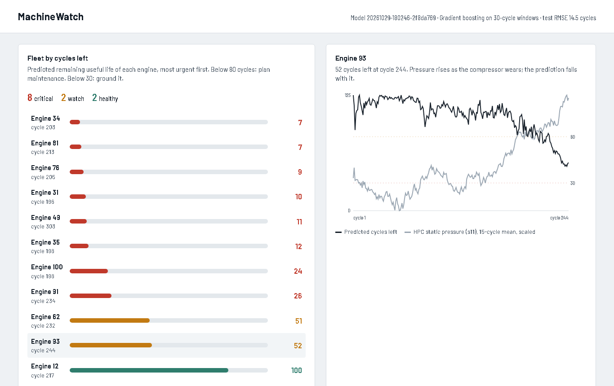

# MachineWatch

**Predictive maintenance for a fleet of turbofan engines.** Sensor readings stream in one engine cycle at a time. A model predicts each engine's remaining useful life (RUL), and a live dashboard ranks the fleet by urgency.

[](https://github.com/vacelni/machinewatch/actions/workflows/ci.yml)




```bash
docker compose up --build      # then open http://localhost:8000
```

The build downloads the NASA data, trains and evaluates the model, and starts the API. A simulator then replays 12 engines as if their sensors were reporting live.

## Results on NASA C-MAPSS FD001

Each model is trained on 100 engines that run to failure. It is scored on the **official test set**: 100 other engines whose records stop at an unknown point before failure. Model selection uses 5-fold cross-validation grouped by engine, so no engine is ever on both sides of a split.

| Model | Test RMSE (cycles) | Test NASA score | Test MAE | CV RMSE |
|---|---|---|---|---|
| Ridge on the current sensor readings | 21.69 | 1,287 | 17.4 | 20.92 |
| **Gradient boosting on 30-cycle windows** | **14.48** | **290** | **11.2** | **13.07** |

The NASA score is the competition metric for this dataset. It penalises predicting too *many* cycles left more than too few, because a late prediction means an engine fails in service. Lower is better. The numbers come from `results/metrics.json`, written by `python -m machinewatch.train`.

**Limitation, stated plainly:** 62% of the test predictions are on the optimistic side, the risky direction. A production version should shift predictions toward the conservative side, or train directly on the asymmetric cost.

## How it works

```
simulator ──POST /api/readings──▶ FastAPI ──▶ SQLite (readings, predictions)
  (12 engines,  X-API-Key            │
   cycle by cycle)                   ├─ features from the engine's last 30 cycles
                                     ├─ model from the registry ──▶ RUL + status
                                     └─ GET /api/stream (server-sent events) ──▶ dashboard
```

- **Features use the past only.** For each sensor: the current value, plus the mean, spread and least-squares slope over the last 30 cycles. Wear shows up as drift, for example the HPC static pressure `s11` rising, well before any single reading looks unusual. The same function serves training, evaluation and the API. A test proves that the features at cycle *t* do not change when later cycles are added, and that the API, which reads back only the last 30 cycles, gets exactly the offline features.
- **Capped target.** Early in life an engine shows no measurable wear, so training targets are capped at 125 cycles. This is the standard piecewise-linear setup for C-MAPSS.
- **Model registry with a promotion gate.** Every trained model is stored with its metrics and a SHA-256 checksum. A new model becomes the served one only if its test RMSE is at least as good. Loading refuses a file whose checksum does not match, which matters because `joblib` unpickles.
- **Ingestion is idempotent.** A reading is keyed by (engine, cycle), so a retried POST is never counted twice. When `MACHINEWATCH_INGEST_KEY` is set, the API requires a key and compares it in constant time.
- **Status that a planner acts on.** Each engine gets a status from its predicted cycles left:
  - *healthy*: 80 or more;
  - *watch*: under 80, plan maintenance;
  - *critical*: under 30, ground it.

## Run without Docker

```bash
python -m venv .venv && .venv/Scripts/activate            # or source .venv/bin/activate
pip install -r requirements-dev.txt
python -m machinewatch.train                              # downloads data, trains, evaluates, registers
MACHINEWATCH_ALLOW_RESET=1 uvicorn machinewatch.api:app   # http://localhost:8000
python -m machinewatch.simulator --rate 20                # in a second terminal
pytest -q                                                 # 17 tests, no download needed
```

## API

| Endpoint | Purpose |
|---|---|
| `POST /api/readings` | One cycle of one engine: `unit`, `cycle`, 3 `settings`, sensors `s1`–`s21`. Returns the prediction. |
| `GET /api/fleet` | Latest prediction per engine, most urgent first |
| `GET /api/engines/{unit}` | Prediction history with the sensors shown on the chart |
| `GET /api/model` | Served model version, name and test metrics |
| `GET /api/stream` | Server-sent events, one per new prediction |

## Data

A. Saxena, K. Goebel, D. Simon and N. Eklund, *Damage Propagation Modeling for Aircraft Engine Run-to-Failure Simulation*, PHM 2008. The data comes from the NASA Prognostics Center of Excellence data repository and is downloaded on demand, not redistributed. FD001 has one operating condition and one fault mode: high-pressure compressor degradation.

## Why this project

A clean-room project: public data only, no code or data from any employer. It shows how I approach predictive maintenance: honest evaluation, features that cannot see the future, a model registry that cannot ship a worse model, and a live view an operator would actually use.

## License

[MIT](LICENSE) © Vacelnino Faiz Fadeli
